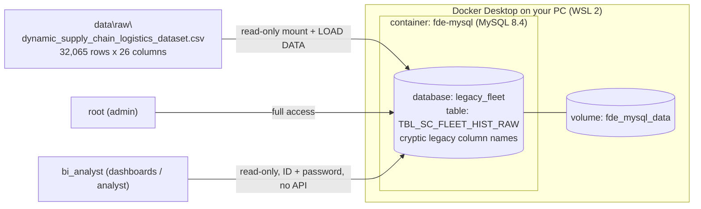

# Step 1: Legacy System Setup Guide (Windows 10/11, PowerShell)

**Project:** Cold-Chain Logistics FDE (FDE_PB_Sol)
**What you build:** the "legacy enterprise database" from the architecture diagram, which is MySQL 8.4 LTS running in Docker and loaded with the fleet telemetry CSV
**Machine:** 64-bit Windows 11 (23H2 or newer) or Windows 10 (22H2, build 19045), 8 GB RAM, hardware virtualization turned on, PowerShell
**Version:** 1.0, 24 Nov 2026
**Using a Mac?** Follow [01_Legacy_System_Setup_Guide_macOS.md](01_Legacy_System_Setup_Guide_macOS.md) instead. Both guides build exactly the same system.

---

## How to use this guide

- Open **Windows Terminal** or **Windows PowerShell** (press the Windows key, type *PowerShell*, press Enter). Do **not** use *PowerShell ISE*, because step H1 needs a real terminal.
- A few steps in Part C need an **administrator** terminal: right-click the Start button → **Terminal (Admin)**. Those steps say so; use a normal terminal for everything else.
- Work through the parts **in order**. Each step has three parts:
  **What it does** → **Command** (copy the whole grey block and paste it into PowerShell) → **Expected output**.
- Every command block starts with this line, which moves to the project folder:
  `Set-Location "$([Environment]::GetFolderPath('MyDocuments'))\FDE_PB_Sol"`
  It finds your real *Documents* folder, even if OneDrive has moved it. **If you keep the project somewhere else**, for example `C:\ClaudeWorks\FDE_PB_Sol`, replace that first line with `Set-Location "C:\ClaudeWorks\FDE_PB_Sol"` every time.
- Each expected output carries one of two labels:
  - ***captured***: the real output from running this project's scripts against the real CSV in a test environment (see Appendix C). Everything in Parts F, G and H runs **inside the Linux container**, so its output is the same on Windows and on a Mac.
  - ***example***: typical output. Version numbers, paths, IDs and timings on your PC will be different.
- The same Docker commands work in Windows PowerShell 5.1 (included with Windows) and in PowerShell 7.

### What you will have at the end



| Item | Value |
|---|---|
| Container | `fde-mysql` (image `mysql:8.4`) |
| Port | `127.0.0.1:3306` (reachable from this PC only) |
| Data volume | `fde_mysql_data` (data survives restarts) |
| Database / table | `legacy_fleet` / `TBL_SC_FLEET_HIST_RAW` |
| Logins | `root` (admin) and `bi_analyst` (read-only) |
| Rows loaded | 32,065 hourly readings, 1 Jan 2021 00:00 to 29 Aug 2024 00:00, all 26 CSV columns |

---

## Part A: Put the project on this PC

### A1. Copy the project folder

**What it does:** Puts the whole `FDE_PB_Sol` folder (with `data`, `legacy_system`, `docs` and so on) into your **Documents** folder.

Copy it from your Mac with a USB stick, OneDrive or a zip file, or clone it with git if you keep it in a repository. A zip made on a Mac may also contain a `__MACOSX` folder and `.DS_Store` files; they are harmless and you can delete them.

```powershell
Set-Location "$([Environment]::GetFolderPath('MyDocuments'))\FDE_PB_Sol"
Get-Location
Test-Path .\data\raw\dynamic_supply_chain_logistics_dataset.csv
```

**Expected output** (*example*). The last line must be `True`:

```text
Path
----
C:\Users\<you>\Documents\FDE_PB_Sol

True
```

If you see `Cannot find path`, the folder is not in Documents: move it there, or use your own path (see *How to use this guide*).

> **OneDrive users:** if your Documents folder syncs with OneDrive, right-click the `FDE_PB_Sol` folder → **Always keep on this device**. Docker cannot read files that exist only in the cloud.

### A2. Look at the project structure

```powershell
Set-Location "$([Environment]::GetFolderPath('MyDocuments'))\FDE_PB_Sol"
Get-ChildItem -Recurse -Force -Name | Where-Object { $_ -notmatch 'DS_Store|__MACOSX' } | Sort-Object
```

**Expected output** (*example*; you will also see `.env` here if you copied it from the Mac):

```text
.env.example
.gitattributes
.gitignore
data
data\policy
data\policy\README.md
data\raw
data\raw\dynamic_supply_chain_logistics_dataset.csv
data\source
data\source\data.txt
docs
docs\01_Legacy_System_Setup_Guide_macOS.md
docs\01_Legacy_System_Setup_Guide_Windows.md
legacy_system
legacy_system\create_env.ps1
legacy_system\create_env.sh
legacy_system\docker-compose.yml
legacy_system\mysql
legacy_system\mysql\scripts
legacy_system\mysql\scripts\01_create_legacy_schema.sql
legacy_system\mysql\scripts\02_create_bi_analyst.sh
legacy_system\mysql\scripts\03_load_legacy_data.sql
legacy_system\mysql\scripts\04_verify_load.sql
legacy_system\mysql\scripts\run_sql.sh
README.md
src_maf
src_maf\README.md
```

| Path | What it is |
|---|---|
| `data\raw\` | The downloaded CSV (source of truth, never modified) |
| `data\source\data.txt` | Where the data came from (Kaggle link) |
| `data\policy\` | Empty for now; SOP documents go here in a later step |
| `legacy_system\docker-compose.yml` | Defines the MySQL container, port, volume and folder mounts |
| `legacy_system\create_env.ps1` | Creates your private `.env` with hidden password prompts (Windows) |
| `legacy_system\create_env.sh` | The same for macOS (not used on Windows) |
| `legacy_system\mysql\scripts\` | SQL and helper scripts that run **inside** the Linux container |
| `docs\` | This guide and its macOS edition |
| `src_maf\` | Empty for now; the AI solution goes here in a later step |
| `.env.example` | Settings template (no secrets) |
| `.gitignore`, `.gitattributes` | Keep secrets out of git; keep Unix line endings in the container scripts |

### A3. Check the line endings of the container scripts

**What it does:** The `.sh` scripts run inside a **Linux** container. If Windows line endings (CRLF) got into them, for example through a git setting or an editor, they fail with `set: Illegal option -`. This step checks them.

```powershell
Set-Location "$([Environment]::GetFolderPath('MyDocuments'))\FDE_PB_Sol"
Get-ChildItem .\legacy_system\mysql\scripts\*.sh | ForEach-Object { if ([IO.File]::ReadAllText($_.FullName).Contains("`r")) { "$($_.Name): Windows line endings - run the fix below" } else { "$($_.Name): OK" } }
```

**Expected output** (*example*):

```text
02_create_bi_analyst.sh: OK
run_sql.sh: OK
```

**Only if a file is not OK**, convert the scripts to Unix line endings and then run the check again:

```powershell
Set-Location "$([Environment]::GetFolderPath('MyDocuments'))\FDE_PB_Sol"
Get-ChildItem .\legacy_system\mysql\scripts\* -Include *.sh, *.sql | ForEach-Object { [IO.File]::WriteAllText($_.FullName, ([IO.File]::ReadAllText($_.FullName) -replace "`r`n", "`n")) }
```

---

## Part B: Check your PC

### B1. Check the Windows version

**What it does:** Docker Desktop needs 64-bit Windows 11 23H2 (build 22631) or newer, or Windows 10 22H2 (build 19045).

```powershell
Set-Location "$([Environment]::GetFolderPath('MyDocuments'))\FDE_PB_Sol"
$os = Get-CimInstance Win32_OperatingSystem
"{0} | build {1} | {2}" -f $os.Caption, $os.BuildNumber, $os.OSArchitecture
$env:PROCESSOR_ARCHITECTURE
```

**Expected output** (*example*). The build must be 19045 or higher, and the architecture must be 64-bit:

```text
Microsoft Windows 11 Pro | build 26100 | 64-bit
AMD64
```

(`ARM64` on the last line means a Windows-on-ARM PC. That works too; the image in E1 will then show `linux/arm64`.)

### B2. Check virtualization and WSL 2

**What it does:** Docker Desktop runs Linux containers inside **WSL 2** (Windows Subsystem for Linux), which needs hardware virtualization.

1. Press **Ctrl + Shift + Esc** to open Task Manager → **Performance** → **CPU**. Under the graph, **Virtualization** must say **Enabled**. If it says *Disabled*, see **J3**.
2. Check WSL:

```powershell
Set-Location "$([Environment]::GetFolderPath('MyDocuments'))\FDE_PB_Sol"
wsl --version
```

**Expected output** (*example*). If you see a WSL version of **2.1.5 or higher**, skip C1:

```text
WSL version: 2.6.1.0
Kernel version: 6.6.87.2-1
WSLg version: 1.0.66
...
Windows version: 10.0.26100.6584
```

If you see an error, a help text or a lower version, do **C1**.

### B3. Check winget (the Windows package manager)

```powershell
Set-Location "$([Environment]::GetFolderPath('MyDocuments'))\FDE_PB_Sol"
winget --version
```

**Expected output** (*example*): `v1.12.350`. If `winget` is not recognized, install **App Installer** from the Microsoft Store, or use the download link in C2.

### B4. Check whether Docker is installed

```powershell
Set-Location "$([Environment]::GetFolderPath('MyDocuments'))\FDE_PB_Sol"
if (Get-Command docker -ErrorAction SilentlyContinue) { docker --version } else { "Docker is NOT installed - do step C2" }
```

**Expected output** (*example*). Either a version, which means you skip C2 and go to C3:

```text
Docker version 29.1.2, build 0f2b1c3
```

or `Docker is NOT installed - do step C2`.

### B5. Check that port 3306 is free

**What it does:** MySQL listens on port 3306. A MySQL already installed on Windows (often the service `MySQL80`) would clash with it.

```powershell
Set-Location "$([Environment]::GetFolderPath('MyDocuments'))\FDE_PB_Sol"
$p = Get-NetTCPConnection -LocalPort 3306 -State Listen -ErrorAction SilentlyContinue
if ($p) { $p | Select-Object LocalAddress, LocalPort, @{n='Program';e={(Get-Process -Id $_.OwningProcess).ProcessName}} } else { "Port 3306 is free" }
```

**Expected output** (*example*):

```text
Port 3306 is free
```

If a program is listed instead (for example `mysqld`), see **J4** before you continue.

---

## Part C: Install what is missing

### C1. Install or update WSL 2 (skip if B2 showed 2.1.5 or higher)

**What it does:** Installs the WSL 2 feature without a Linux distribution, because Docker Desktop brings its own. **Use an administrator terminal** (right-click Start → **Terminal (Admin)**).

```powershell
wsl --install --no-distribution
wsl --update
```

**Expected output** (*example*):

```text
Installing: Windows Subsystem for Linux
Windows Subsystem for Linux has been installed.
The requested operation is successful. Changes will not be effective until the system is rebooted.
Checking for updates.
The most recent version of Windows Subsystem for Linux is already installed.
```

If Windows answers that `--no-distribution` is not a valid option (older WSL), run `wsl --install` instead. It also installs Ubuntu, which does no harm. **Restart your PC**, then run **B2** again to confirm.

### C2. Install Docker Desktop (skip if B4 showed a version)

**What it does:** Installs Docker Desktop, which includes the `docker` and `docker compose` commands. Windows may show a permission (UAC) prompt; click **Yes**.

```powershell
Set-Location "$([Environment]::GetFolderPath('MyDocuments'))\FDE_PB_Sol"
winget install -e --id Docker.DockerDesktop --accept-package-agreements --accept-source-agreements
```

**Expected output** (*example*, last lines):

```text
Found Docker Desktop [Docker.DockerDesktop] Version 4.99.0
...
Successfully installed
```

If the installer asks you to **log out** or **restart**, do it. Afterwards, open a **new** PowerShell window, because the `docker` command is only found in windows opened after the install.

> **No winget?** Download *Docker Desktop for Windows* from <https://www.docker.com/products/docker-desktop/> and run `Docker Desktop Installer.exe`. Keep **Use WSL 2 instead of Hyper-V** ticked.
>
> **Licence:** Docker Desktop is free for personal use, education and small businesses. Larger enterprises (more than 250 employees or more than USD 10 million in annual revenue) need a paid subscription, so check Docker's pricing page if this is company work.

### C3. Start Docker Desktop and wait until it is ready

**What it does:** Starts Docker Desktop and waits until its engine is running.

**On the very first start only**, a Docker window opens. In it:
1. Accept the *Docker Subscription Service Agreement*.
2. Signing in is optional; you can skip it.
3. Leave **Use the WSL 2 based engine** on (it is the default).

```powershell
Set-Location "$([Environment]::GetFolderPath('MyDocuments'))\FDE_PB_Sol"
$dd = @("$env:ProgramFiles\Docker\Docker\Docker Desktop.exe", "$env:LOCALAPPDATA\Programs\DockerDesktop\Docker Desktop.exe") | Where-Object { Test-Path $_ } | Select-Object -First 1
if ($dd) { Start-Process $dd } else { "Start Docker Desktop from the Start menu, then run the next lines" }
if (Get-Command docker -ErrorAction SilentlyContinue) { while ($true) { docker info *> $null; if ($LASTEXITCODE -eq 0) { break }; "waiting for Docker to start..."; Start-Sleep -Seconds 3 }; docker --version; docker compose version } else { "docker command not found - open a NEW PowerShell window and run this block again" }
```

**Expected output** (*example*). The "waiting" line may repeat for up to a minute:

```text
waiting for Docker to start...
waiting for Docker to start...
Docker version 29.1.2, build 0f2b1c3
Docker Compose version v5.0.1
```

> Optional: in Docker Desktop → **Settings → General**, tick *Start Docker Desktop when you sign in to your computer*. Docker then starts by itself after a reboot.

> **You do not install MySQL on Windows itself.** Docker downloads the official MySQL image in step E1 and runs MySQL inside a Linux container. That is all the "MySQL installation" there is.

---

## Part D: Create your private settings file (.env)

### D1. Create .env with two passwords

**What it does:** Asks for two new passwords, one for the MySQL admin user `root` and one for the read-only login `bi_analyst`. While you type, you will only see `*` characters. The script:
- asks for each password twice;
- needs at least 8 characters, using only letters, digits and `_ @ % + = . -`;
- never shows the passwords and never overwrites an existing `.env`;
- writes `.env` in a format Docker and Python read the same way on every OS, and limits it to your Windows user.

`-ExecutionPolicy Bypass` lets this one script run even if running scripts is switched off on your PC. It changes no setting.

**Choose passwords you will remember.** You need the `bi_analyst` password in Part H.

```powershell
Set-Location "$([Environment]::GetFolderPath('MyDocuments'))\FDE_PB_Sol"
powershell -NoProfile -ExecutionPolicy Bypass -File .\legacy_system\create_env.ps1
```

**Expected output** (*example*; same lines as the tested macOS version):

```text
Creating C:\Users\<you>\Documents\FDE_PB_Sol\.env

New password for the MySQL admin user 'root' (hidden): ************
Type it again: ************

New password for the read-only login 'bi_analyst' (hidden): ***********
Type it again: ***********

OK: .env created (passwords not shown). Settings in the file:
DB_ENGINE=MYSQL
MYSQL_HOST=127.0.0.1
MYSQL_PORT=3306
MYSQL_ADMIN_USER=root
MYSQL_ROOT_PASSWORD=******** (set)
LEGACY_DB=legacy_fleet
LEGACY_TABLE=TBL_SC_FLEET_HIST_RAW
BI_ANALYST_USER=bi_analyst
BI_ANALYST_PASSWORD=******** (set)
```

If you mistype, the script says why (for example `x The two entries are different. Please try again.`) and asks again. If you copied a `.env` from the Mac, the script keeps it and says `already exists`; the same passwords then apply on this PC.

### D2. Back up .env outside the project

**What it does:** Saves a private copy in your user folder. MySQL keeps the **first** root password for good (see J8), so this backup can save you a full reset.

```powershell
Set-Location "$([Environment]::GetFolderPath('MyDocuments'))\FDE_PB_Sol"
Copy-Item .env "$HOME\fde_pb_sol_env_backup.env"
"Backup saved to $HOME\fde_pb_sol_env_backup.env"
```

**Expected output** (*example*): `Backup saved to C:\Users\<you>\fde_pb_sol_env_backup.env`

### D3. Check .env any time without showing the passwords

```powershell
Set-Location "$([Environment]::GetFolderPath('MyDocuments'))\FDE_PB_Sol"
Get-Content .env | Where-Object { $_ -cmatch '^[A-Z_]+=' } | ForEach-Object { $_ -creplace '^([A-Z_]*PASSWORD)=.+$', '$1=******** (set)' }
```

**Expected output** (*example*): the same 9 lines as in D1, with `******** (set)` next to both passwords. If a password line ends with just `=`, that password is empty, so rename `.env` (`Rename-Item .env .env.old`) and run D1 again.

---

## Part E: Install and start MySQL (the legacy server)

### E1. Download the MySQL 8.4 image (the MySQL "installation")

**What it does:** Downloads the official MySQL 8.4 LTS image from Docker Hub (about 250 MB).

```powershell
Set-Location "$([Environment]::GetFolderPath('MyDocuments'))\FDE_PB_Sol"
docker pull mysql:8.4
docker image inspect mysql:8.4 --format 'Image ready: {{.Os}}/{{.Architecture}}'
```

**Expected output** (*example*):

```text
8.4: Pulling from library/mysql
...
Digest: sha256:4c1f...
Status: Downloaded newer image for mysql:8.4
docker.io/library/mysql:8.4
Image ready: linux/amd64
```

### E2. Start the legacy MySQL container

**What it does:** Creates and starts the container `fde-mysql`, using the passwords from `.env`. It mounts two folders read-only: the CSV folder (as `/import/raw`) and the scripts folder (as `/scripts`). The `--wait` option returns only once MySQL is ready. **The first start takes 30–60 seconds**, because MySQL sets up its data files.

```powershell
Set-Location "$([Environment]::GetFolderPath('MyDocuments'))\FDE_PB_Sol"
docker compose -f legacy_system/docker-compose.yml --env-file .env up -d --wait
```

**Expected output** (*example*):

```text
[+] Running 3/3
 ✔ Network fde-legacy_default  Created
 ✔ Volume "fde_mysql_data"     Created
 ✔ Container fde-mysql         Healthy
```

### E3. Check that the server is running and can see your files

**What it does:** Shows the container status and the MySQL version, and checks that the CSV and the scripts are visible inside the container.

```powershell
Set-Location "$([Environment]::GetFolderPath('MyDocuments'))\FDE_PB_Sol"
docker compose -f legacy_system/docker-compose.yml --env-file .env ps
docker exec fde-mysql mysql --version
docker exec fde-mysql ls -l /import/raw /scripts
```

**Expected output** (*example*). Look for `(healthy)`, `8.4.x`, the CSV of about 15 MB and the five script files:

```text
NAME        IMAGE       COMMAND                  SERVICE   CREATED          STATUS                    PORTS
fde-mysql   mysql:8.4   "docker-entrypoint.s…"   mysql     1 minute ago     Up 1 minute (healthy)     127.0.0.1:3306->3306/tcp, 33060/tcp
mysql  Ver 8.4.13 for Linux on x86_64 (MySQL Community Server - GPL)
/import/raw:
total 15100
-rwxrwxrwx 1 root root 15459276 Nov 21 10:03 dynamic_supply_chain_logistics_dataset.csv

/scripts:
total 24
-rwxrwxrwx 1 root root 3926 Nov 24 15:00 01_create_legacy_schema.sql
-rwxrwxrwx 1 root root 1303 Nov 24 15:00 02_create_bi_analyst.sh
-rwxrwxrwx 1 root root 3234 Nov 24 15:00 03_load_legacy_data.sql
-rwxrwxrwx 1 root root 4789 Nov 24 15:01 04_verify_load.sql
-rwxrwxrwx 1 root root 1274 Nov 24 15:00 run_sql.sh
```

---

## Part F: Build the legacy database and load the CSV

All the SQL runs **inside** the container through `run_sql.sh`. That helper takes the root password from the container's settings, so you never type it and it never appears on screen.

### F1. Create the legacy database and table

**What it does:** Creates the database `legacy_fleet` and the table `TBL_SC_FLEET_HIST_RAW`, with **all 26 CSV columns under cryptic legacy names** (for example `IOT_TEMP_VAL_C`, `RISK_CLS_TXT`) plus 3 system columns. It is safe to run again, because nothing is dropped. Appendix A lists every column.

```powershell
Set-Location "$([Environment]::GetFolderPath('MyDocuments'))\FDE_PB_Sol"
docker exec fde-mysql sh /scripts/run_sql.sh /scripts/01_create_legacy_schema.sql
```

**Expected output** (*captured*):

```text
+---------------------------------------------+
| status                                      |
+---------------------------------------------+
| legacy_fleet.TBL_SC_FLEET_HIST_RAW is ready |
+---------------------------------------------+
+------------------+
| columns_in_table |
+------------------+
|               29 |
+------------------+
```

### F2. Create the read-only "BI analyst" login

**What it does:** Creates the login `bi_analyst` with the password from `.env`. It can **read** everything in `legacy_fleet` and change nothing, in the same way that dashboards and analysts reach a legacy database with an ID and password and no API. It is safe to run again (this also resets the password to the value in `.env`).

```powershell
Set-Location "$([Environment]::GetFolderPath('MyDocuments'))\FDE_PB_Sol"
docker exec fde-mysql sh /scripts/02_create_bi_analyst.sh
```

**Expected output** (*captured*):

```text
+-------------------------------------------------------+
| status                                                |
+-------------------------------------------------------+
| bi_analyst can now log in (read-only on legacy_fleet) |
+-------------------------------------------------------+
+------------------------------------------------------+
| Grants for bi_analyst@%                              |
+------------------------------------------------------+
| GRANT USAGE ON *.* TO `bi_analyst`@`%`               |
| GRANT SELECT ON `legacy_fleet`.* TO `bi_analyst`@`%` |
+------------------------------------------------------+
```

(`USAGE` means "may log in"; it grants no rights to any data.)

### F3. Load the CSV into the legacy table

**What it does:** Empties the table, then loads **every row and all 26 columns** of `data\raw\dynamic_supply_chain_logistics_dataset.csv` using MySQL's fast `LOAD DATA` command. It turns the text timestamp into a real date-time and reports any value it could not store. It takes a few seconds. It is safe to run again, because the table is emptied first and duplicates are therefore impossible. A CSV that was saved with Windows line endings still loads correctly.

```powershell
Set-Location "$([Environment]::GetFolderPath('MyDocuments'))\FDE_PB_Sol"
docker exec fde-mysql sh /scripts/run_sql.sh /scripts/03_load_legacy_data.sql
```

**Expected output** (*captured*). `load_warnings` must be **0** and `rows_loaded` must be **32065**:

```text
+--------------------------------------------------+
| status                                           |
+--------------------------------------------------+
| 1/3  Emptying legacy_fleet.TBL_SC_FLEET_HIST_RAW |
+--------------------------------------------------+
+---------------------------------------------------------------------+
| status                                                              |
+---------------------------------------------------------------------+
| 2/3  Loading /import/raw/dynamic_supply_chain_logistics_dataset.csv |
+---------------------------------------------------------------------+
+---------------+
| load_warnings |
+---------------+
|             0 |
+---------------+
+--------------------+-------------+---------------------+---------------------+
| status             | rows_loaded | first_reading       | last_reading        |
+--------------------+-------------+---------------------+---------------------+
| 3/3  Load finished |       32065 | 2021-01-01 00:00:00 | 2024-08-29 00:00:00 |
+--------------------+-------------+---------------------+---------------------+
```

If a value cannot be stored (for example text in a number column), a table of up to 5 warnings appears above `load_warnings`, naming the column and the row.

---

## Part G: Verify the load

### G1. Run the 13-point check

**What it does:** Compares the table with values computed **directly from the CSV file**: row count, date range, risk counts, missing values, column count, and three checksums that prove the first, a middle and the last numeric columns landed in the right place with full precision. It only reads and changes nothing.

```powershell
Set-Location "$([Environment]::GetFolderPath('MyDocuments'))\FDE_PB_Sol"
docker exec fde-mysql sh /scripts/run_sql.sh /scripts/04_verify_load.sql
```

**Expected output** (*captured*). The last line must read **ALL 13 CHECKS PASSED**:

```text
+--------------+----------+
| reading_year | readings |
+--------------+----------+
|         2021 |     8760 |
|         2022 |     8760 |
|         2023 |     8760 |
|         2024 |     5785 |
+--------------+----------+
+---------------+----------+
| risk_class    | readings |
+---------------+----------+
| High Risk     |    23944 |
| Moderate Risk |     5011 |
| Low Risk      |     3110 |
+---------------+----------+
+------------+------------+----------+--------------+----------+
| min_temp_c | max_temp_c | below_0c | from_0_to_4c | above_4c |
+------------+------------+----------+--------------+----------+
|        -10 |         40 |    21817 |         1574 |     8674 |
+------------+------------+----------+--------------+----------+
+----+------------------------------------------+---------------------+---------------------+--------+
| #  | check_name                               | expected            | actual              | result |
+----+------------------------------------------+---------------------+---------------------+--------+
|  1 | Rows loaded                              | 32065               | 32065               | PASS   |
|  2 | Distinct hourly timestamps               | 32065               | 32065               | PASS   |
|  3 | First reading                            | 2021-01-01 00:00:00 | 2021-01-01 00:00:00 | PASS   |
|  4 | Last reading                             | 2024-08-29 00:00:00 | 2024-08-29 00:00:00 | PASS   |
|  5 | High Risk rows                           | 23944               | 23944               | PASS   |
|  6 | Moderate Risk rows                       | 5011                | 5011                | PASS   |
|  7 | Low Risk rows                            | 3110                | 3110                | PASS   |
|  8 | Rows with a missing value                | 0                   | 0                   | PASS   |
|  9 | Columns in table (26 data + 3 system)    | 29                  | 29                  | PASS   |
| 10 | Checksum SUM(FUEL_CONS_RT)  - column 4   | 256896.28           | 256896.28           | PASS   |
| 11 | Checksum SUM(IOT_TEMP_VAL_C) - column 17 | 1436.24             | 1436.24             | PASS   |
| 12 | Checksum SUM(DLV_TM_DEV)    - column 26  | 166021.29           | 166021.29           | PASS   |
| 13 | Rows with SYS_INGEST_FLAG = Y            | 32065               | 32065               | PASS   |
+----+------------------------------------------+---------------------+---------------------+--------+
+---------------------------------------------------+
| verdict                                           |
+---------------------------------------------------+
| ALL 13 CHECKS PASSED - the legacy system is ready |
+---------------------------------------------------+
```

> **Worth noticing for later steps:** 21,817 of the 32,065 readings (68%) are **below 0 °C**, and only 1,574 fall in the 0–4 °C range the SOP sets for fresh perishables. Your HLD and LLD flag the same gap.

**The legacy system is now complete.** 🎉

---

## Part H: Use it the way a legacy user would

### H1. Log in as the read-only analyst

**What it does:** Opens the MySQL command line inside the container as `bi_analyst`. Type the **bi_analyst password** from D1 when asked; it stays invisible while you type.

```powershell
Set-Location "$([Environment]::GetFolderPath('MyDocuments'))\FDE_PB_Sol"
docker exec -it fde-mysql mysql -u bi_analyst -p legacy_fleet
```

At the `mysql>` prompt, paste these lines. The last one tries to delete a row, to prove that the login is read-only:

```sql
SHOW TABLES;
SELECT TS_UTC, V_LAT, V_LON, IOT_TEMP_VAL_C, RISK_CLS_TXT, DELAY_PROB_DEC FROM TBL_SC_FLEET_HIST_RAW ORDER BY TS_UTC DESC LIMIT 3;
SELECT COUNT(*) FROM TBL_SC_FLEET_HIST_RAW WHERE IOT_TEMP_VAL_C > 4 AND RISK_CLS_TXT = 'High Risk';
DELETE FROM TBL_SC_FLEET_HIST_RAW WHERE REC_ID = 1;
```

**Expected output** (*captured* result tables; in the interactive shell each one is also followed by a line such as `3 rows in set (0.00 sec)`):

```text
+------------------------+
| Tables_in_legacy_fleet |
+------------------------+
| TBL_SC_FLEET_HIST_RAW  |
+------------------------+
+---------------------+--------------------+--------------------+--------------------+---------------+--------------------+
| TS_UTC              | V_LAT              | V_LON              | IOT_TEMP_VAL_C     | RISK_CLS_TXT  | DELAY_PROB_DEC     |
+---------------------+--------------------+--------------------+--------------------+---------------+--------------------+
| 2024-08-29 00:00:00 |  38.57648248950679 | -94.57954243970406 |  18.79651453879272 | High Risk     | 0.9992302873270055 |
| 2024-08-28 23:00:00 |  32.08241012776637 | -70.07015390298147 | -6.951137131277026 | High Risk     | 0.5573400961448669 |
| 2024-08-28 22:00:00 | 42.963337864840994 | -82.14987252451516 | 29.410878231505777 | Moderate Risk | 0.9591972134481881 |
+---------------------+--------------------+--------------------+--------------------+---------------+--------------------+
+----------+
| COUNT(*) |
+----------+
|     6455 |
+----------+
ERROR 1142 (42000): DELETE command denied to user 'bi_analyst'@'localhost' for table 'TBL_SC_FLEET_HIST_RAW'
```

The error on the last line is the expected result: the analyst can read but cannot change data. To see all 29 cryptic column names, type `DESCRIBE TBL_SC_FLEET_HIST_RAW;`. Type `exit` to leave.

> This is what makes the system "legacy": cryptic column names, access only by ID and password, no API, and you need to know the schema to ask anything. The AI steps that follow fix exactly this.

### H2. (Optional) Connect from a desktop tool

Any MySQL tool on Windows (MySQL Workbench, DBeaver, HeidiSQL, or the VS Code *MySQL* extension) can connect with:

| Setting | Value |
|---|---|
| Host | `127.0.0.1` |
| Port | `3306` (or `MYSQL_PORT` from `.env`) |
| User | `bi_analyst` (read-only) or `root` (admin) |
| Password | from your `.env` |
| Database | `legacy_fleet` |

---

## Part I: Daily operations

### I1. Stop MySQL (the data is kept)

```powershell
Set-Location "$([Environment]::GetFolderPath('MyDocuments'))\FDE_PB_Sol"
docker compose -f legacy_system/docker-compose.yml --env-file .env stop
```

**Expected output** (*example*): `✔ Container fde-mysql  Stopped`

### I2. Start again (quick start, for example after a reboot)

Start Docker Desktop with the **C3** block, then:

```powershell
Set-Location "$([Environment]::GetFolderPath('MyDocuments'))\FDE_PB_Sol"
docker compose -f legacy_system/docker-compose.yml --env-file .env up -d --wait
```

**Expected output** (*example*): `✔ Container fde-mysql  Healthy`. Your data is still there, so there is no need to reload. Run **G1** if you want to confirm.

### I3. Check status and logs

```powershell
Set-Location "$([Environment]::GetFolderPath('MyDocuments'))\FDE_PB_Sol"
docker compose -f legacy_system/docker-compose.yml --env-file .env ps
docker logs --tail 20 fde-mysql
```

The last log line of a healthy server contains `ready for connections`.

### I4. Reload the CSV (for example after replacing the file)

Run **F3** and then **G1** again. The table is emptied first, so no duplicates are created. If you replace the CSV with a different download, the expected values in G1 apply only to the original file.

### I5. Change the bi_analyst password

Open `.env` with `notepad .env`, change the `BI_ANALYST_PASSWORD` line (same character rules as in D1), save and close Notepad. Then:

```powershell
Set-Location "$([Environment]::GetFolderPath('MyDocuments'))\FDE_PB_Sol"
docker compose -f legacy_system/docker-compose.yml --env-file .env up -d --wait
docker exec fde-mysql sh /scripts/02_create_bi_analyst.sh
```

### I6. Full reset (⚠️ deletes ALL database data and logins)

**What it does:** Removes the container **and the data volume**. Use it to start over cleanly, for example after changing the root password in `.env`. Your CSV and project files are **not** touched.

```powershell
Set-Location "$([Environment]::GetFolderPath('MyDocuments'))\FDE_PB_Sol"
docker compose -f legacy_system/docker-compose.yml --env-file .env down -v
```

**Expected output** (*example*):

```text
[+] Running 3/3
 ✔ Container fde-mysql         Removed
 ✔ Volume fde_mysql_data       Removed
 ✔ Network fde-legacy_default  Removed
```

Then rebuild with **E2 → F1 → F2 → F3 → G1**.

---

## Part J: Troubleshooting

| # | You see | Why | Fix |
|---|---|---|---|
| J1 | `error during connect: … open //./pipe/dockerDesktopLinuxEngine: The system cannot find the file specified` | Docker Desktop is not running | Run the **C3** block |
| J2 | `docker : The term 'docker' is not recognized …` | Docker Desktop is not installed, or this window was opened before the install | Open a **new** PowerShell window; if it still fails, do **C2** |
| J3 | Docker Desktop says *Virtualization support not detected* or *WSL 2 installation is incomplete*, or Task Manager shows Virtualization *Disabled* | Virtualization is off in the BIOS/UEFI, or WSL is missing or outdated | Turn on **Intel VT-x** or **AMD-V/SVM** in the BIOS/UEFI setup (the PC maker's support page shows how), then run **C1** in an admin terminal and restart |
| J4 | `Bind for 127.0.0.1:3306 failed: port is already allocated`, or B5 listed a program | Another MySQL is using port 3306 (often the Windows service `MySQL80`) | Either stop it in an admin terminal with `Stop-Service MySQL80` (and `Set-Service MySQL80 -StartupType Manual` to keep it off after a reboot), or run `notepad .env`, set `MYSQL_PORT=3307`, save, and run **E2** again (then use port 3307 in H2) |
| J5 | `create_env.ps1 cannot be loaded because running scripts is disabled on this system` | The script was started without `-ExecutionPolicy Bypass` | Use the exact **D1** command. If your company blocks even that, copy `.env.example` to `.env` (`Copy-Item .env.example .env`), open it with `notepad .env` and fill in both passwords |
| J6 | `set: Illegal option -` or `$'\r': command not found` when running F1–F3 | Windows line endings got into the `.sh` scripts | Run the fix in **A3**, then repeat the failed step |
| J7 | `required variable MYSQL_ROOT_PASSWORD is missing a value` | `.env` is missing, or the command was not run from the project folder with `--env-file .env` | Copy the full block again (it starts with `Set-Location …`); if `.env` is missing, run **D1** |
| J8 | `ERROR 1045 (28000): Access denied for user 'root'` | The root password in `.env` was changed **after** the first start. MySQL keeps the password from the day the volume was created | Put the old password back (`Copy-Item "$HOME\fde_pb_sol_env_backup.env" .env`) and run **E2**, or do a full reset (**I6**) |
| J9 | `ERROR 1045 … for user 'bi_analyst'` in H1 | Wrong password typed, or `.env` changed without re-running F2 | Check the password in `.env` (`notepad .env`), then run **I5** |
| J10 | `ERROR 3948 (42000) at line 27: Loading local data is disabled` | The container was started without this project's settings (for example a manual `docker run`) | Remove it with `docker rm -f fde-mysql` and run **E2** (your data volume is kept) |
| J11 | `ERROR 2 (HY000) at line 27: File '/import/raw/…' not found`, or the folders look empty in E3 | The CSV was renamed or moved, or OneDrive keeps it only in the cloud | The file must be exactly `data\raw\dynamic_supply_chain_logistics_dataset.csv`. With OneDrive, right-click the project folder → **Always keep on this device**. Then run `docker compose -f legacy_system/docker-compose.yml --env-file .env down` followed by **E2** |
| J12 | E2 waits a long time, then reports that `fde-mysql` is unhealthy | MySQL stopped with an error during start-up (a slow first start is covered by the 3-minute wait) | Read the error with `docker logs --tail 50 fde-mysql`. If the data volume is damaged or half-created, do a full reset (**I6**) and run **E2** again |
| J13 | `load_warnings` above 0 in F3, or a FAIL in G1 | The CSV differs from the original download (for example it was opened and re-saved in Excel) | Look at the listed warnings (column and row), restore the original CSV from Kaggle (`data\source\data.txt`), then run **F3** and **G1** |
| J14 | `the input device is not a TTY` in H1 | The command was run in PowerShell ISE or Git Bash | Use Windows Terminal or the normal PowerShell window. In Git Bash, put `winpty` in front of the command |
| J15 | `permission denied` mentioning `docker-users` | Your Windows user is not in the `docker-users` group (can happen with an all-users install) | In an admin terminal: `net localgroup docker-users "$env:USERDOMAIN\$env:USERNAME" /add`, then sign out and back in |
| J16 | `pull access denied` or a network error in E1 | No internet, or a company proxy is blocking Docker Hub | Check your connection or VPN (Docker Desktop → Settings → Resources → Proxies) and try **E1** again |

---

## Appendix A: Legacy column mapping (all 26 CSV columns)

The legacy table keeps **every** CSV column under a cryptic name, the way an old enterprise system would. The ✔ column marks the 9 columns that the AI step will later expose through the readable view `vw_active_fleet`, using exactly the names in your HLD (Table 8-2). The other 17 stay available for future questions (fuel, traffic, driver fatigue and so on).

| # | CSV column | Legacy column | Type | Later AI view (HLD 8-2) |
|---|---|---|---|---|
| – | *(system)* | `REC_ID` | BIGINT, auto number | – (row number, **not** a shipment ID) |
| 1 | timestamp | `TS_UTC` | DATETIME | ✔ Timestamp |
| 2 | vehicle_gps_latitude | `V_LAT` | DOUBLE | ✔ Latitude |
| 3 | vehicle_gps_longitude | `V_LON` | DOUBLE | ✔ Longitude |
| 4 | fuel_consumption_rate | `FUEL_CONS_RT` | DOUBLE | |
| 5 | eta_variation_hours | `ETA_VAR_HRS` | DOUBLE | |
| 6 | traffic_congestion_level | `TRF_CNG_LVL` | DOUBLE | |
| 7 | warehouse_inventory_level | `WH_INV_LVL` | DOUBLE | |
| 8 | loading_unloading_time | `LD_ULD_TM` | DOUBLE | |
| 9 | handling_equipment_availability | `HDL_EQP_AVL` | DOUBLE | |
| 10 | order_fulfillment_status | `ORD_FUL_STS` | DOUBLE | |
| 11 | weather_condition_severity | `WX_SEV_IDX` | DOUBLE | |
| 12 | port_congestion_level | `PRT_CNG_LVL` | DOUBLE | ✔ Port_Congestion_Level |
| 13 | shipping_costs | `SHP_CST_AMT` | DOUBLE | |
| 14 | supplier_reliability_score | `SUP_REL_SCR` | DOUBLE | |
| 15 | lead_time_days | `LEAD_TM_DAYS` | DOUBLE | |
| 16 | historical_demand | `HIST_DMD_QTY` | DOUBLE | |
| 17 | iot_temperature | `IOT_TEMP_VAL_C` | DOUBLE | ✔ Current_Temperature_C |
| 18 | cargo_condition_status | `CGO_COND_CD` | DOUBLE | ✔ Cargo_Condition_Code |
| 19 | route_risk_level | `RT_RSK_IDX` | DOUBLE | ✔ Route_Risk_Index |
| 20 | customs_clearance_time | `CUST_CLR_TM` | DOUBLE | |
| 21 | driver_behavior_score | `DRV_BHV_SCR` | DOUBLE | |
| 22 | fatigue_monitoring_score | `DRV_FTG_SCR` | DOUBLE | |
| 23 | disruption_likelihood_score | `DSRP_LKH_SCR` | DOUBLE | |
| 24 | delay_probability | `DELAY_PROB_DEC` | DOUBLE | ✔ Delay_Probability |
| 25 | risk_classification | `RISK_CLS_TXT` | VARCHAR(50) | ✔ Risk_Classification |
| 26 | delivery_time_deviation | `DLV_TM_DEV` | DOUBLE | |
| – | *(system)* | `SYS_INGEST_FLAG` | CHAR(1), always `Y` | – |
| – | *(system)* | `SYS_LOAD_TS` | DATETIME, load time (UTC) | – |

**Differences from the HLD and LLD v1.2, recorded for the next document revision:**
- The HLD (8.1) and LLD (13.1) say the loader keeps 9 of the 26 columns. Step 1 keeps **all 26**, at your request; the 9 HLD names are unchanged.
- The LLD lists numeric columns as FLOAT. Step 1 uses **DOUBLE**, so every value keeps the full precision of the CSV (for example `18.79651453879272`).
- Step 1 adds `REC_ID`, `SYS_LOAD_TS` and an index on `TS_UTC` (which speeds up "latest reading" questions).
- The HLD run guide uses `C:\ClaudeWorks\cold-chain-logistics-FDE-Project`; this guide uses `Documents\FDE_PB_Sol` (any folder works; see *How to use this guide*).
- None of this affects the later view, which selects its 9 columns by name.

**Not in the data:** the architecture diagram also mentions speed, engine health, distance and stops. The CSV has no such columns, so they cannot appear in any step unless a new data source is added.

## Appendix B: Files created in Step 1

| File | Runs on | Purpose |
|---|---|---|
| `legacy_system\docker-compose.yml` | PC (Docker) | Container `fde-mysql`, image `mysql:8.4`, port `127.0.0.1:3306`, volume `fde_mysql_data`, read-only mounts of the CSV and scripts, health check, server options (`local-infile`, utf8mb4, UTC) |
| `legacy_system\create_env.ps1` | Windows (PowerShell 5.1 or 7) | Creates `.env` with hidden, validated password prompts; UTF-8 without BOM, Unix line endings; limited to your user; never overwrites or prints |
| `legacy_system\create_env.sh` | macOS (bash) | The same for the Mac |
| `legacy_system\mysql\scripts\run_sql.sh` | Container | Runs a SQL file as root, reading the password from the container's settings |
| `legacy_system\mysql\scripts\01_create_legacy_schema.sql` | Container | Database `legacy_fleet` and table `TBL_SC_FLEET_HIST_RAW` (29 columns) |
| `legacy_system\mysql\scripts\02_create_bi_analyst.sh` | Container | Read-only login `bi_analyst` |
| `legacy_system\mysql\scripts\03_load_legacy_data.sql` | Container | Empties the table, then loads the full CSV with `LOAD DATA` |
| `legacy_system\mysql\scripts\04_verify_load.sql` | Container | 13-point PASS/FAIL check against values computed from the CSV |
| `.env.example` / `.env` | – | Settings template (no secrets) / your private settings (git-ignored) |
| `README.md`, `.gitignore`, `.gitattributes` | – | Project overview; keeps secrets out of git; keeps LF line endings in container scripts |

## Appendix C: What was tested

| Item | How | Result |
|---|---|---|
| F1–F3, G1 and H1 SQL scripts | Run exactly as written, through `run_sql.sh`, against **MySQL 8.0.46** on Linux with your real CSV. The container paths `/scripts` and `/import/raw` were set up the same way. These scripts always run inside the Linux container, so Windows does not change them. Docker Hub was not reachable from the test environment, so the `mysql:8.4` image itself could not be run there. | All outputs marked *captured*; ALL 13 CHECKS PASSED; re-runs created no duplicates |
| Windows line endings | The SQL scripts and the CSV converted to CRLF, and one `.sh` script converted to CRLF | The SQL scripts and the CSV still work (ALL 13 CHECKS PASSED). The CRLF `.sh` script fails with `set: Illegal option -`, so this guide adds the A3 check and fix plus `.gitattributes` |
| `.env` read by Docker Compose | `docker compose config` with a `.env` that has CRLF line endings, and one with a UTF-8 BOM | Both read correctly (values without stray characters) |
| `docker-compose.yml` | `docker compose config` (Compose v5.7.1), with and without `--env-file .env` | Valid; without `.env` it stops with a clear "missing a value" message |
| **Not run** | The PowerShell commands, `create_env.ps1`, winget, WSL and Docker Desktop on Windows (no Windows or PowerShell was available in the test environment). They were written for Windows PowerShell 5.1 and PowerShell 7 and checked by reading. | Their outputs are marked *example*. If any PowerShell step misbehaves, tell me the exact message and I will fix it |
