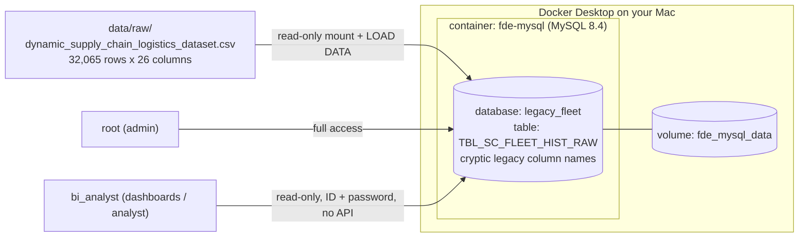

# Step 1: Legacy System Setup Guide (macOS, Apple Silicon)

**Project:** Cold-Chain Logistics FDE (FDE_PB_Sol)
**What you build:** the "legacy enterprise database" from the architecture diagram, which is MySQL 8.4 LTS running in Docker and loaded with the fleet telemetry CSV
**Machine:** MacBook with Apple Silicon (M-series), macOS 14 Sonoma or newer, Terminal app (zsh)
**Version:** 1.1, 24 Nov 2026 (1.1: file renamed with `_macOS`; a Windows edition was added)
**Using Windows?** Follow [01_Legacy_System_Setup_Guide_Windows.md](01_Legacy_System_Setup_Guide_Windows.md) instead. Both guides build exactly the same system.

---

## How to use this guide

- Open the **Terminal** app (press `Cmd + Space`, type *Terminal*, press Enter).
- Work through the parts **in order**. Each step has three parts:
  **What it does** → **Command** (copy the whole grey block and paste it into Terminal) → **Expected output**.
- Every command block starts with `cd ~/Documents/FDE_PB_Sol`, so you can run any block on its own.
- Each expected output carries one of two labels:
  - ***captured***: the real output from running this project's scripts against the real CSV in a test environment (see Appendix C).
  - ***example***: typical output. Version numbers, IDs and timings on your Mac will be different.
- The command blocks contain no `#` comments, because zsh does not accept them when you paste.

### What you will have at the end



| Item | Value |
|---|---|
| Container | `fde-mysql` (image `mysql:8.4`) |
| Port | `127.0.0.1:3306` (reachable from this Mac only) |
| Data volume | `fde_mysql_data` (data survives restarts) |
| Database / table | `legacy_fleet` / `TBL_SC_FLEET_HIST_RAW` |
| Logins | `root` (admin) and `bi_analyst` (read-only) |
| Rows loaded | 32,065 hourly readings, 1 Jan 2021 00:00 to 29 Aug 2024 00:00, all 26 CSV columns |

---

## Part A: Check your Mac

### A1. Check the macOS version and chip

**What it does:** Docker Desktop needs macOS 14 or newer. `arm64` means Apple Silicon.

```bash
cd ~/Documents/FDE_PB_Sol
sw_vers -productVersion
uname -m
```

**Expected output** (*example*). The first line must be 14 or higher, and the second must be `arm64`:

```text
15.6
arm64
```

### A2. Check whether Homebrew is installed

**What it does:** Homebrew is the package manager this guide uses to install Docker Desktop.

```bash
cd ~/Documents/FDE_PB_Sol
command -v brew >/dev/null && brew --version || echo "Homebrew is NOT installed - do step B1"
```

**Expected output** (*example*). Either a version, which means you can skip B1:

```text
Homebrew 5.0.3
```

or `Homebrew is NOT installed - do step B1`.

### A3. Check whether Docker is installed

```bash
cd ~/Documents/FDE_PB_Sol
command -v docker >/dev/null && docker --version || echo "Docker is NOT installed - do step B2"
```

**Expected output** (*example*). Either a version, which means you skip B2 and go to B3:

```text
Docker version 29.1.2, build 0f2b1c3
```

or `Docker is NOT installed - do step B2`.

### A4. Check that port 3306 is free

**What it does:** MySQL listens on port 3306. If another MySQL is already running on your Mac, the two would clash.

```bash
cd ~/Documents/FDE_PB_Sol
lsof -nP -iTCP:3306 -sTCP:LISTEN || echo "Port 3306 is free"
```

**Expected output** (*example*):

```text
Port 3306 is free
```

If a program is listed instead, see **J2** in Troubleshooting before you continue.

---

## Part B: Install what is missing

### B1. Install Homebrew (skip if A2 showed a version)

**What it does:** Installs Homebrew. You will be asked for your **Mac login password**, which stays invisible while you type. Press **Return** when asked to continue. The installer may also install Apple's *Command Line Tools*, which takes a few minutes.

```bash
cd ~/Documents/FDE_PB_Sol
/bin/bash -c "$(curl -fsSL https://raw.githubusercontent.com/Homebrew/install/HEAD/install.sh)"
```

Next, add Homebrew to your shell so the `brew` command works now and in every new Terminal window:

```bash
cd ~/Documents/FDE_PB_Sol
echo >> ~/.zprofile
echo 'eval "$(/opt/homebrew/bin/brew shellenv)"' >> ~/.zprofile
eval "$(/opt/homebrew/bin/brew shellenv)"
brew --version
```

**Expected output** (*example*):

```text
Homebrew 5.0.3
```

### B2. Install Docker Desktop (skip if A3 showed a version)

**What it does:** Installs the Docker Desktop app, which includes the `docker` and `docker compose` commands. You may be asked for your Mac password.

```bash
cd ~/Documents/FDE_PB_Sol
brew install --cask docker-desktop
```

**Expected output** (*example*, last lines):

```text
==> Installing Cask docker-desktop
==> Moving App 'Docker.app' to '/Applications/Docker.app'
🍺  docker-desktop was successfully installed!
```

> **No Homebrew?** You can download *Docker Desktop for Mac with Apple silicon* from <https://www.docker.com/products/docker-desktop/>, open the `.dmg` and drag Docker to Applications.
>
> **Licence:** Docker Desktop is free for personal use, education and small businesses. Larger enterprises (more than 250 employees or more than USD 10 million in annual revenue) need a paid subscription, so check Docker's pricing page if this is company work.

### B3. Start Docker Desktop and wait until it is ready

**What it does:** Opens Docker Desktop and waits until its engine is running.

**On the very first start only**, a Docker window opens. In it:
1. Accept the *Docker Subscription Service Agreement*.
2. Choose **Use recommended settings** and enter your Mac password if asked.
3. Signing in is optional; you can skip it.

```bash
cd ~/Documents/FDE_PB_Sol
open -a Docker
until docker info >/dev/null 2>&1; do echo "waiting for Docker to start..."; sleep 3; done
docker --version
docker compose version
```

**Expected output** (*example*). The "waiting" line may repeat for up to a minute:

```text
waiting for Docker to start...
waiting for Docker to start...
Docker version 29.1.2, build 0f2b1c3
Docker Compose version v5.0.1
```

> Optional: in Docker Desktop → **Settings → General**, tick *Start Docker Desktop when you sign in to your computer*. Docker then starts by itself after a reboot.

> **You do not install MySQL on the Mac itself.** Docker downloads the official MySQL image in step E1 and runs MySQL inside a container. That is all the "MySQL installation" there is.

---

## Part C: Check the project folder

### C1. Look at the project structure

**What it does:** Lists the project files. Your CSV stays where it is: in `data/raw`, unchanged.

```bash
cd ~/Documents/FDE_PB_Sol
find . -maxdepth 4 -not -name '.DS_Store' | sort
```

**Expected output** (*captured* on your folder after Step 1 was set up; on the Mac the sort order of a few lines may differ slightly):

```text
.
./.env.example
./.gitattributes
./.gitignore
./README.md
./data
./data/policy
./data/policy/README.md
./data/raw
./data/raw/dynamic_supply_chain_logistics_dataset.csv
./data/source
./data/source/data.txt
./docs
./docs/01_Legacy_System_Setup_Guide_Windows.md
./docs/01_Legacy_System_Setup_Guide_macOS.md
./legacy_system
./legacy_system/create_env.ps1
./legacy_system/create_env.sh
./legacy_system/docker-compose.yml
./legacy_system/mysql
./legacy_system/mysql/scripts
./legacy_system/mysql/scripts/01_create_legacy_schema.sql
./legacy_system/mysql/scripts/02_create_bi_analyst.sh
./legacy_system/mysql/scripts/03_load_legacy_data.sql
./legacy_system/mysql/scripts/04_verify_load.sql
./legacy_system/mysql/scripts/run_sql.sh
./src_maf
./src_maf/README.md
```

| Path | What it is |
|---|---|
| `data/raw/` | The downloaded CSV (source of truth, never modified) |
| `data/source/data.txt` | Where the data came from (Kaggle link) |
| `data/policy/` | Empty for now; SOP documents go here in a later step |
| `legacy_system/docker-compose.yml` | Defines the MySQL container, port, volume and folder mounts |
| `legacy_system/create_env.sh` | Creates your private `.env` with hidden password prompts (macOS) |
| `legacy_system/create_env.ps1` | The same for Windows (not used on the Mac) |
| `legacy_system/mysql/scripts/` | SQL and helper scripts that run **inside** the container |
| `docs/` | This guide and its Windows edition |
| `src_maf/` | Empty for now; the AI solution goes here in a later step |
| `.env.example` | Settings template (no secrets) |
| `.gitignore` | Keeps `.env` and other private or generated files out of git |
| `.gitattributes` | Keeps Unix line endings in the container scripts when the project is used on Windows through git |

---

## Part D: Create your private settings file (.env)

### D1. Create .env with two passwords

**What it does:** Asks for two new passwords, one for the MySQL admin user `root` and one for the read-only login `bi_analyst`. Nothing appears on screen while you type, which is normal. The script:
- asks for each password twice;
- needs at least 8 characters, using only letters, digits and `_ @ % + = . -`;
- never shows the passwords and never overwrites an existing `.env`.

**Choose passwords you will remember.** You need the `bi_analyst` password in Part H.

```bash
cd ~/Documents/FDE_PB_Sol
bash legacy_system/create_env.sh
```

**Expected output** (*captured* from a test run with valid entries; the passwords are never shown):

```text
Creating /Users/<you>/Documents/FDE_PB_Sol/.env

New password for the MySQL admin user 'root' (hidden):
Type it again:

New password for the read-only login 'bi_analyst' (hidden):
Type it again:

OK: .env created (passwords not shown). Settings in the file:
DB_ENGINE=MYSQL
MYSQL_HOST=127.0.0.1
MYSQL_PORT=3306
MYSQL_ADMIN_USER=root
MYSQL_ROOT_PASSWORD=******** (set)
LEGACY_DB=legacy_fleet
LEGACY_TABLE=TBL_SC_FLEET_HIST_RAW
BI_ANALYST_USER=bi_analyst
BI_ANALYST_PASSWORD=******** (set)
```

If you mistype, the script says why (for example `x The two entries are different. Please try again.`) and asks again.

### D2. Back up .env outside the project

**What it does:** Saves a private copy in your home folder. MySQL keeps the **first** root password for good (see J4), so this backup can save you a full reset.

```bash
cd ~/Documents/FDE_PB_Sol
cp .env ~/fde_pb_sol_env_backup.env && chmod 600 ~/fde_pb_sol_env_backup.env && echo "Backup saved to ~/fde_pb_sol_env_backup.env"
```

**Expected output** (*example*):

```text
Backup saved to ~/fde_pb_sol_env_backup.env
```

### D3. Check .env any time without showing the passwords

```bash
cd ~/Documents/FDE_PB_Sol
grep -E '^[A-Z_]+=' .env | sed -E 's/^([A-Z_]*PASSWORD)=.+$/\1=******** (set)/'
```

**Expected output** (*captured*): the same 9 lines as in D1, with `******** (set)` next to both passwords. If a password line ends with just `=`, that password is empty, so run D1 again after `mv .env .env.old`.

---

## Part E: Install and start MySQL (the legacy server)

### E1. Download the MySQL 8.4 image (the MySQL "installation")

**What it does:** Downloads the official MySQL 8.4 LTS image from Docker Hub (about 250 MB). On Apple Silicon you get the native `arm64` build.

```bash
cd ~/Documents/FDE_PB_Sol
docker pull mysql:8.4
docker image inspect mysql:8.4 --format 'Image ready: {{.Os}}/{{.Architecture}}'
```

**Expected output** (*example*):

```text
8.4: Pulling from library/mysql
...
Digest: sha256:4c1f...
Status: Downloaded newer image for mysql:8.4
docker.io/library/mysql:8.4
Image ready: linux/arm64
```

### E2. Start the legacy MySQL container

**What it does:** Creates and starts the container `fde-mysql`, using the passwords from `.env`. It mounts two folders read-only: the CSV folder (as `/import/raw`) and the scripts folder (as `/scripts`). The `--wait` option returns only once MySQL is ready. **The first start takes 30–60 seconds**, because MySQL sets up its data files.

```bash
cd ~/Documents/FDE_PB_Sol
docker compose -f legacy_system/docker-compose.yml --env-file .env up -d --wait
```

> **macOS permission pop-up:** if you see *"Docker" would like to access files in your Documents folder*, click **Allow**. Without it, the container cannot see the CSV or the scripts (see J6).

**Expected output** (*example*):

```text
[+] Running 3/3
 ✔ Network fde-legacy_default  Created
 ✔ Volume "fde_mysql_data"     Created
 ✔ Container fde-mysql         Healthy
```

### E3. Check that the server is running and can see your files

**What it does:** Shows the container status and the MySQL version, and checks that the CSV and the scripts are visible inside the container.

```bash
cd ~/Documents/FDE_PB_Sol
docker compose -f legacy_system/docker-compose.yml --env-file .env ps
docker exec fde-mysql mysql --version
docker exec fde-mysql ls -l /import/raw /scripts
```

**Expected output** (*example*). Look for `(healthy)`, `8.4.x`, the CSV of about 15 MB and the five script files:

```text
NAME        IMAGE       COMMAND                  SERVICE   CREATED          STATUS                    PORTS
fde-mysql   mysql:8.4   "docker-entrypoint.s…"   mysql     1 minute ago     Up 1 minute (healthy)     127.0.0.1:3306->3306/tcp, 33060/tcp
mysql  Ver 8.4.13 for Linux on aarch64 (MySQL Community Server - GPL)
/import/raw:
total 15100
-rw-r--r-- 1 root root 15459276 Nov 21 10:03 dynamic_supply_chain_logistics_dataset.csv

/scripts:
total 24
-rw-r--r-- 1 root root 3926 Nov 24 15:00 01_create_legacy_schema.sql
-rw-r--r-- 1 root root 1303 Nov 24 15:00 02_create_bi_analyst.sh
-rw-r--r-- 1 root root 3234 Nov 24 15:00 03_load_legacy_data.sql
-rw-r--r-- 1 root root 4789 Nov 24 15:01 04_verify_load.sql
-rw-r--r-- 1 root root 1274 Nov 24 15:00 run_sql.sh
```

---

## Part F: Build the legacy database and load the CSV

All the SQL runs **inside** the container through `run_sql.sh`. That helper takes the root password from the container's settings, so you never type it and it never appears on screen.

### F1. Create the legacy database and table

**What it does:** Creates the database `legacy_fleet` and the table `TBL_SC_FLEET_HIST_RAW`, with **all 26 CSV columns under cryptic legacy names** (for example `IOT_TEMP_VAL_C`, `RISK_CLS_TXT`) plus 3 system columns. It is safe to run again, because nothing is dropped. Appendix A lists every column.

```bash
cd ~/Documents/FDE_PB_Sol
docker exec fde-mysql sh /scripts/run_sql.sh /scripts/01_create_legacy_schema.sql
```

**Expected output** (*captured*):

```text
+---------------------------------------------+
| status                                      |
+---------------------------------------------+
| legacy_fleet.TBL_SC_FLEET_HIST_RAW is ready |
+---------------------------------------------+
+------------------+
| columns_in_table |
+------------------+
|               29 |
+------------------+
```

### F2. Create the read-only "BI analyst" login

**What it does:** Creates the login `bi_analyst` with the password from `.env`. It can **read** everything in `legacy_fleet` and change nothing, in the same way that dashboards and analysts reach a legacy database with an ID and password and no API. It is safe to run again (this also resets the password to the value in `.env`).

```bash
cd ~/Documents/FDE_PB_Sol
docker exec fde-mysql sh /scripts/02_create_bi_analyst.sh
```

**Expected output** (*captured*):

```text
+-------------------------------------------------------+
| status                                                |
+-------------------------------------------------------+
| bi_analyst can now log in (read-only on legacy_fleet) |
+-------------------------------------------------------+
+------------------------------------------------------+
| Grants for bi_analyst@%                              |
+------------------------------------------------------+
| GRANT USAGE ON *.* TO `bi_analyst`@`%`               |
| GRANT SELECT ON `legacy_fleet`.* TO `bi_analyst`@`%` |
+------------------------------------------------------+
```

(`USAGE` means "may log in"; it grants no rights to any data.)

### F3. Load the CSV into the legacy table

**What it does:** Empties the table, then loads **every row and all 26 columns** of `data/raw/dynamic_supply_chain_logistics_dataset.csv` using MySQL's fast `LOAD DATA` command. It turns the text timestamp into a real date-time and reports any value it could not store. It takes a few seconds. It is safe to run again, because the table is emptied first and duplicates are therefore impossible.

```bash
cd ~/Documents/FDE_PB_Sol
docker exec fde-mysql sh /scripts/run_sql.sh /scripts/03_load_legacy_data.sql
```

**Expected output** (*captured*). `load_warnings` must be **0** and `rows_loaded` must be **32065**:

```text
+--------------------------------------------------+
| status                                           |
+--------------------------------------------------+
| 1/3  Emptying legacy_fleet.TBL_SC_FLEET_HIST_RAW |
+--------------------------------------------------+
+---------------------------------------------------------------------+
| status                                                              |
+---------------------------------------------------------------------+
| 2/3  Loading /import/raw/dynamic_supply_chain_logistics_dataset.csv |
+---------------------------------------------------------------------+
+---------------+
| load_warnings |
+---------------+
|             0 |
+---------------+
+--------------------+-------------+---------------------+---------------------+
| status             | rows_loaded | first_reading       | last_reading        |
+--------------------+-------------+---------------------+---------------------+
| 3/3  Load finished |       32065 | 2021-01-01 00:00:00 | 2024-08-29 00:00:00 |
+--------------------+-------------+---------------------+---------------------+
```

If a value cannot be stored (for example text in a number column), a table of up to 5 warnings appears above `load_warnings`, naming the column and the row.

---

## Part G: Verify the load

### G1. Run the 13-point check

**What it does:** Compares the table with values computed **directly from the CSV file**: row count, date range, risk counts, missing values, column count, and three checksums that prove the first, a middle and the last numeric columns landed in the right place with full precision. It only reads and changes nothing.

```bash
cd ~/Documents/FDE_PB_Sol
docker exec fde-mysql sh /scripts/run_sql.sh /scripts/04_verify_load.sql
```

**Expected output** (*captured*). The last line must read **ALL 13 CHECKS PASSED**:

```text
+--------------+----------+
| reading_year | readings |
+--------------+----------+
|         2021 |     8760 |
|         2022 |     8760 |
|         2023 |     8760 |
|         2024 |     5785 |
+--------------+----------+
+---------------+----------+
| risk_class    | readings |
+---------------+----------+
| High Risk     |    23944 |
| Moderate Risk |     5011 |
| Low Risk      |     3110 |
+---------------+----------+
+------------+------------+----------+--------------+----------+
| min_temp_c | max_temp_c | below_0c | from_0_to_4c | above_4c |
+------------+------------+----------+--------------+----------+
|        -10 |         40 |    21817 |         1574 |     8674 |
+------------+------------+----------+--------------+----------+
+----+------------------------------------------+---------------------+---------------------+--------+
| #  | check_name                               | expected            | actual              | result |
+----+------------------------------------------+---------------------+---------------------+--------+
|  1 | Rows loaded                              | 32065               | 32065               | PASS   |
|  2 | Distinct hourly timestamps               | 32065               | 32065               | PASS   |
|  3 | First reading                            | 2021-01-01 00:00:00 | 2021-01-01 00:00:00 | PASS   |
|  4 | Last reading                             | 2024-08-29 00:00:00 | 2024-08-29 00:00:00 | PASS   |
|  5 | High Risk rows                           | 23944               | 23944               | PASS   |
|  6 | Moderate Risk rows                       | 5011                | 5011                | PASS   |
|  7 | Low Risk rows                            | 3110                | 3110                | PASS   |
|  8 | Rows with a missing value                | 0                   | 0                   | PASS   |
|  9 | Columns in table (26 data + 3 system)    | 29                  | 29                  | PASS   |
| 10 | Checksum SUM(FUEL_CONS_RT)  - column 4   | 256896.28           | 256896.28           | PASS   |
| 11 | Checksum SUM(IOT_TEMP_VAL_C) - column 17 | 1436.24             | 1436.24             | PASS   |
| 12 | Checksum SUM(DLV_TM_DEV)    - column 26  | 166021.29           | 166021.29           | PASS   |
| 13 | Rows with SYS_INGEST_FLAG = Y            | 32065               | 32065               | PASS   |
+----+------------------------------------------+---------------------+---------------------+--------+
+---------------------------------------------------+
| verdict                                           |
+---------------------------------------------------+
| ALL 13 CHECKS PASSED - the legacy system is ready |
+---------------------------------------------------+
```

> **Worth noticing for later steps:** 21,817 of the 32,065 readings (68%) are **below 0 °C**, and only 1,574 fall in the 0–4 °C range the SOP sets for fresh perishables. Your HLD and LLD flag the same gap.

**The legacy system is now complete.** 🎉

---

## Part H: Use it the way a legacy user would

### H1. Log in as the read-only analyst

**What it does:** Opens the MySQL command line inside the container as `bi_analyst`. Type the **bi_analyst password** from D1 when asked; it stays invisible while you type.

```bash
cd ~/Documents/FDE_PB_Sol
docker exec -it fde-mysql mysql -u bi_analyst -p legacy_fleet
```

At the `mysql>` prompt, paste these lines. The last one tries to delete a row, to prove that the login is read-only:

```sql
SHOW TABLES;
SELECT TS_UTC, V_LAT, V_LON, IOT_TEMP_VAL_C, RISK_CLS_TXT, DELAY_PROB_DEC FROM TBL_SC_FLEET_HIST_RAW ORDER BY TS_UTC DESC LIMIT 3;
SELECT COUNT(*) FROM TBL_SC_FLEET_HIST_RAW WHERE IOT_TEMP_VAL_C > 4 AND RISK_CLS_TXT = 'High Risk';
DELETE FROM TBL_SC_FLEET_HIST_RAW WHERE REC_ID = 1;
```

**Expected output** (*captured* result tables; in the interactive shell each one is also followed by a line such as `3 rows in set (0.00 sec)`):

```text
+------------------------+
| Tables_in_legacy_fleet |
+------------------------+
| TBL_SC_FLEET_HIST_RAW  |
+------------------------+
+---------------------+--------------------+--------------------+--------------------+---------------+--------------------+
| TS_UTC              | V_LAT              | V_LON              | IOT_TEMP_VAL_C     | RISK_CLS_TXT  | DELAY_PROB_DEC     |
+---------------------+--------------------+--------------------+--------------------+---------------+--------------------+
| 2024-08-29 00:00:00 |  38.57648248950679 | -94.57954243970406 |  18.79651453879272 | High Risk     | 0.9992302873270055 |
| 2024-08-28 23:00:00 |  32.08241012776637 | -70.07015390298147 | -6.951137131277026 | High Risk     | 0.5573400961448669 |
| 2024-08-28 22:00:00 | 42.963337864840994 | -82.14987252451516 | 29.410878231505777 | Moderate Risk | 0.9591972134481881 |
+---------------------+--------------------+--------------------+--------------------+---------------+--------------------+
+----------+
| COUNT(*) |
+----------+
|     6455 |
+----------+
ERROR 1142 (42000): DELETE command denied to user 'bi_analyst'@'localhost' for table 'TBL_SC_FLEET_HIST_RAW'
```

The error on the last line is the expected result: the analyst can read but cannot change data. To see all 29 cryptic column names, type `DESCRIBE TBL_SC_FLEET_HIST_RAW;`. Type `exit` to leave.

> This is what makes the system "legacy": cryptic column names, access only by ID and password, no API, and you need to know the schema to ask anything. The AI steps that follow fix exactly this.

### H2. (Optional) Connect from a desktop tool

Any MySQL tool on your Mac (MySQL Workbench, DBeaver, TablePlus, or the VS Code *MySQL* extension) can connect with:

| Setting | Value |
|---|---|
| Host | `127.0.0.1` |
| Port | `3306` (or `MYSQL_PORT` from `.env`) |
| User | `bi_analyst` (read-only) or `root` (admin) |
| Password | from your `.env` |
| Database | `legacy_fleet` |

To use the MySQL command line directly on the Mac instead of inside the container:

```bash
cd ~/Documents/FDE_PB_Sol
brew install mysql-client
"$(brew --prefix mysql-client)/bin/mysql" -h 127.0.0.1 -P 3306 -u bi_analyst -p legacy_fleet
```

---

## Part I: Daily operations

### I1. Stop MySQL (the data is kept)

```bash
cd ~/Documents/FDE_PB_Sol
docker compose -f legacy_system/docker-compose.yml --env-file .env stop
```

**Expected output** (*example*): `✔ Container fde-mysql  Stopped`

### I2. Start again (quick start, for example after a reboot)

```bash
cd ~/Documents/FDE_PB_Sol
open -a Docker
until docker info >/dev/null 2>&1; do echo "waiting for Docker to start..."; sleep 3; done
docker compose -f legacy_system/docker-compose.yml --env-file .env up -d --wait
```

**Expected output** (*example*): `✔ Container fde-mysql  Healthy`. Your data is still there, so there is no need to reload. Run **G1** if you want to confirm.

### I3. Check status and logs

```bash
cd ~/Documents/FDE_PB_Sol
docker compose -f legacy_system/docker-compose.yml --env-file .env ps
docker logs --tail 20 fde-mysql
```

The last log line of a healthy server contains `ready for connections`.

### I4. Reload the CSV (for example after replacing the file)

Run **F3** and then **G1** again. The table is emptied first, so no duplicates are created. If you replace the CSV with a different download, the expected values in G1 apply only to the original file.

### I5. Change the bi_analyst password

Edit `.env` with `nano .env`, change `BI_ANALYST_PASSWORD`, then save with **Ctrl+O**, **Return**, **Ctrl+X**. Then:

```bash
cd ~/Documents/FDE_PB_Sol
docker compose -f legacy_system/docker-compose.yml --env-file .env up -d --wait
docker exec fde-mysql sh /scripts/02_create_bi_analyst.sh
```

### I6. Full reset (⚠️ deletes ALL database data and logins)

**What it does:** Removes the container **and the data volume**. Use it to start over cleanly, for example after changing the root password in `.env`. Your CSV and project files are **not** touched.

```bash
cd ~/Documents/FDE_PB_Sol
docker compose -f legacy_system/docker-compose.yml --env-file .env down -v
```

**Expected output** (*example*):

```text
[+] Running 3/3
 ✔ Container fde-mysql         Removed
 ✔ Volume fde_mysql_data       Removed
 ✔ Network fde-legacy_default  Removed
```

Then rebuild with **E2 → F1 → F2 → F3 → G1**.

---

## Part J: Troubleshooting

| # | You see | Why | Fix |
|---|---|---|---|
| J1 | `Cannot connect to the Docker daemon` or `failed to connect to the docker API` | Docker Desktop is not running | Run the `open -a Docker` and `until …` lines from **B3** |
| J2 | `Bind for 127.0.0.1:3306 failed: port is already allocated`, or A4 listed a program | Another MySQL is using port 3306 | Either stop it (if it came from Homebrew: `brew services stop mysql`), or run `nano .env`, set `MYSQL_PORT=3307`, save, and run **E2** again (then use port 3307 in H2) |
| J3 | `required variable MYSQL_ROOT_PASSWORD is missing a value` | `.env` is missing, or the command was not run from the project folder with `--env-file .env` | Copy the full block again (it starts with `cd ~/Documents/FDE_PB_Sol`); if `.env` is missing, run **D1** |
| J4 | `ERROR 1045 (28000): Access denied for user 'root'` | The root password in `.env` was changed **after** the first start. MySQL keeps the password from the day the volume was created | Put the old password back (`cp ~/fde_pb_sol_env_backup.env .env`) and run **E2**, or do a full reset (**I6**) |
| J5 | `ERROR 1045 … for user 'bi_analyst'` in H1 | Wrong password typed, or `.env` changed without re-running F2 | Check the password in `.env` (`nano .env`), then run **I5** |
| J6 | `sh: cannot open /scripts/run_sql.sh`, `ls: cannot access '/import/raw'`, or the folders look empty in E3 | macOS blocked Docker from reading your Documents folder | Apple menu → **System Settings → Privacy & Security → Files and Folders** (or **Full Disk Access**) → allow **Docker**. Then run `docker compose -f legacy_system/docker-compose.yml --env-file .env down` followed by **E2** |
| J7 | `ERROR 3948 (42000) at line 27: Loading local data is disabled` | The container was started without this project's settings (for example a manual `docker run`) | Remove it with `docker rm -f fde-mysql` and run **E2** (your data volume is kept) |
| J8 | `ERROR 2 (HY000) at line 27: File '/import/raw/…' not found` | The CSV was renamed or moved | The file must be exactly `data/raw/dynamic_supply_chain_logistics_dataset.csv`; check with the last line of **E3** |
| J9 | E2 waits a long time, then reports that `fde-mysql` is unhealthy | MySQL stopped with an error during start-up (a slow first start is covered by the 3-minute wait) | Read the error with `docker logs --tail 50 fde-mysql`. If the data volume is damaged or half-created, do a full reset (**I6**) and run **E2** again |
| J10 | `load_warnings` above 0 in F3, or a FAIL in G1 | The CSV differs from the original download | Look at the listed warnings (column and row), restore the original CSV from Kaggle (`data/source/data.txt`), then run **F3** and **G1** |
| J11 | `zsh: command not found: #` | A `#` comment was pasted into zsh | Paste only the command lines from this guide |
| J12 | `pull access denied` or a network error in E1 | No internet, or a company proxy is blocking Docker Hub | Check your connection or VPN and try **E1** again |

---

## Appendix A: Legacy column mapping (all 26 CSV columns)

The legacy table keeps **every** CSV column under a cryptic name, the way an old enterprise system would. The ✔ column marks the 9 columns that the AI step will later expose through the readable view `vw_active_fleet`, using exactly the names in your HLD (Table 8-2). The other 17 stay available for future questions (fuel, traffic, driver fatigue and so on).

| # | CSV column | Legacy column | Type | Later AI view (HLD 8-2) |
|---|---|---|---|---|
| – | *(system)* | `REC_ID` | BIGINT, auto number | – (row number, **not** a shipment ID) |
| 1 | timestamp | `TS_UTC` | DATETIME | ✔ Timestamp |
| 2 | vehicle_gps_latitude | `V_LAT` | DOUBLE | ✔ Latitude |
| 3 | vehicle_gps_longitude | `V_LON` | DOUBLE | ✔ Longitude |
| 4 | fuel_consumption_rate | `FUEL_CONS_RT` | DOUBLE | |
| 5 | eta_variation_hours | `ETA_VAR_HRS` | DOUBLE | |
| 6 | traffic_congestion_level | `TRF_CNG_LVL` | DOUBLE | |
| 7 | warehouse_inventory_level | `WH_INV_LVL` | DOUBLE | |
| 8 | loading_unloading_time | `LD_ULD_TM` | DOUBLE | |
| 9 | handling_equipment_availability | `HDL_EQP_AVL` | DOUBLE | |
| 10 | order_fulfillment_status | `ORD_FUL_STS` | DOUBLE | |
| 11 | weather_condition_severity | `WX_SEV_IDX` | DOUBLE | |
| 12 | port_congestion_level | `PRT_CNG_LVL` | DOUBLE | ✔ Port_Congestion_Level |
| 13 | shipping_costs | `SHP_CST_AMT` | DOUBLE | |
| 14 | supplier_reliability_score | `SUP_REL_SCR` | DOUBLE | |
| 15 | lead_time_days | `LEAD_TM_DAYS` | DOUBLE | |
| 16 | historical_demand | `HIST_DMD_QTY` | DOUBLE | |
| 17 | iot_temperature | `IOT_TEMP_VAL_C` | DOUBLE | ✔ Current_Temperature_C |
| 18 | cargo_condition_status | `CGO_COND_CD` | DOUBLE | ✔ Cargo_Condition_Code |
| 19 | route_risk_level | `RT_RSK_IDX` | DOUBLE | ✔ Route_Risk_Index |
| 20 | customs_clearance_time | `CUST_CLR_TM` | DOUBLE | |
| 21 | driver_behavior_score | `DRV_BHV_SCR` | DOUBLE | |
| 22 | fatigue_monitoring_score | `DRV_FTG_SCR` | DOUBLE | |
| 23 | disruption_likelihood_score | `DSRP_LKH_SCR` | DOUBLE | |
| 24 | delay_probability | `DELAY_PROB_DEC` | DOUBLE | ✔ Delay_Probability |
| 25 | risk_classification | `RISK_CLS_TXT` | VARCHAR(50) | ✔ Risk_Classification |
| 26 | delivery_time_deviation | `DLV_TM_DEV` | DOUBLE | |
| – | *(system)* | `SYS_INGEST_FLAG` | CHAR(1), always `Y` | – |
| – | *(system)* | `SYS_LOAD_TS` | DATETIME, load time (UTC) | – |

**Differences from the HLD and LLD v1.2, recorded for the next document revision:**
- The HLD (8.1) and LLD (13.1) say the loader keeps 9 of the 26 columns. Step 1 keeps **all 26**, at your request; the 9 HLD names are unchanged.
- The LLD lists numeric columns as FLOAT. Step 1 uses **DOUBLE**, so every value keeps the full precision of the CSV (for example `18.79651453879272`).
- Step 1 adds `REC_ID`, `SYS_LOAD_TS` and an index on `TS_UTC` (which speeds up "latest reading" questions).
- None of this affects the later view, which selects its 9 columns by name.

**Not in the data:** the architecture diagram also mentions speed, engine health, distance and stops. The CSV has no such columns, so they cannot appear in any step unless a new data source is added.

## Appendix B: Files created in Step 1

| File | Runs on | Purpose |
|---|---|---|
| `legacy_system/docker-compose.yml` | Mac (Docker) | Container `fde-mysql`, image `mysql:8.4`, port `127.0.0.1:3306`, volume `fde_mysql_data`, read-only mounts of the CSV and scripts, health check, server options (`local-infile`, utf8mb4, UTC) |
| `legacy_system/create_env.sh` | Mac (bash) | Creates `.env` with hidden, validated password prompts; never overwrites or prints |
| `legacy_system/create_env.ps1` | Windows (PowerShell) | The same for Windows; see the Windows guide |
| `legacy_system/mysql/scripts/run_sql.sh` | Container | Runs a SQL file as root, reading the password from the container's settings |
| `legacy_system/mysql/scripts/01_create_legacy_schema.sql` | Container | Database `legacy_fleet` and table `TBL_SC_FLEET_HIST_RAW` (29 columns) |
| `legacy_system/mysql/scripts/02_create_bi_analyst.sh` | Container | Read-only login `bi_analyst` |
| `legacy_system/mysql/scripts/03_load_legacy_data.sql` | Container | Empties the table, then loads the full CSV with `LOAD DATA` |
| `legacy_system/mysql/scripts/04_verify_load.sql` | Container | 13-point PASS/FAIL check against values computed from the CSV |
| `.env.example` / `.env` | – | Settings template (no secrets) / your private settings (git-ignored) |
| `README.md`, `.gitignore`, `.gitattributes` | – | Project overview; keeps secrets out of git; keeps LF line endings in container scripts |

## Appendix C: What was tested

| Item | How | Result |
|---|---|---|
| F1–F3, G1 and H1 SQL scripts | Run exactly as written, through `run_sql.sh`, against **MySQL 8.0.46** on Linux with your real CSV. The container paths `/scripts` and `/import/raw` were set up the same way. Docker Hub was not reachable from the test environment, so the `mysql:8.4` image itself could not be run there. | All outputs in this guide marked *captured*; ALL 13 CHECKS PASSED; load took under 1 second; re-runs created no duplicates |
| Load error handling | A 5-row copy of the CSV with two bad values and Windows line endings | Both bad values were reported as warnings, and the Windows line endings were handled |
| `bi_analyst` rights | SELECT, DELETE and wrong-password attempts | Read allowed; DELETE denied (ERROR 1142); wrong password denied (ERROR 1045) |
| `create_env.sh` | Mismatched, short and invalid passwords, then valid ones; a second run | Each bad entry rejected with a reason; `.env` created with mode 600; the second run did not overwrite |
| `docker-compose.yml` | `docker compose config` (Compose v5.7.1), with and without `--env-file .env` | Valid; without `.env` it stops with a clear "missing a value" message |
| Expected values in G1 | Computed directly from the CSV in Python | Match the MySQL results exactly |
| **Not run on your Mac** | Homebrew, Docker Desktop, `docker pull`, `docker compose up` | Their outputs are marked *example* |
